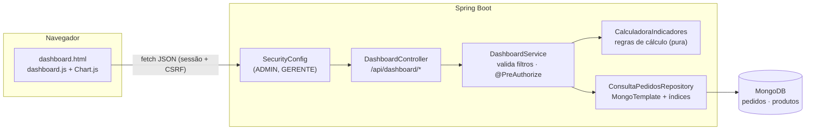
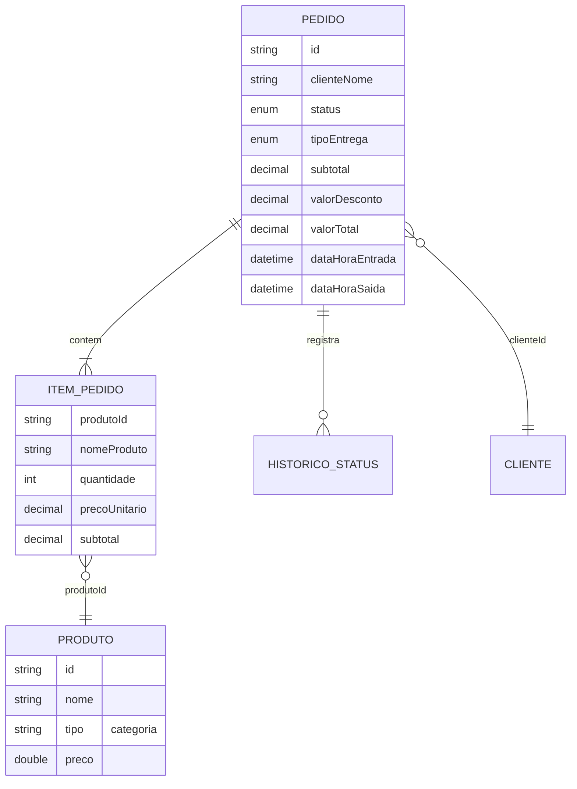

# Dashboard Administrativo — Requisitos, Análise e Projeto

Sistema: **Pediu Patrão** (pedidos de pizzaria/lanchonete) · Java 21, Spring Boot 3.4, Spring Security, MongoDB, Thymeleaf, Chart.js 4.

Documentos relacionados: [API.md](API.md) (endpoints) · [TESTES.md](TESTES.md) (evidências de testes) · [APRESENTACAO.md](APRESENTACAO.md) (roteiro do vídeo).

---

## 1. Contexto e objetivo

O responsável pelo estabelecimento precisa acompanhar o desempenho das vendas, a situação dos pedidos e as tendências da operação para tomar decisões (escala de funcionários nos horários de pico, compras de insumos, promoções, controle de cancelamentos e descontos).

A solução tem duas partes:

1. **API REST de leitura** (`/api/dashboard/*`), projetada a partir das informações que o painel precisa exibir e integrada ao MongoDB já usado pelo sistema.
2. **Dashboard web** (`/dashboard`), que consome somente essa API.

### Atores

| Ator | Acesso ao dashboard | Justificativa |
|---|:-:|---|
| **GERENTE** | ✔ | Responsável pela operação: é quem toma as decisões de venda. |
| **ADMIN** | ✔ | Administra o sistema e acompanha o negócio. |
| ATENDENTE | ✘ | Opera os pedidos do dia e não precisa de dados financeiros consolidados (princípio do menor privilégio). |

---

## 2. Requisitos funcionais

### RF01 — Indicadores gerais de vendas

Exibir, para o período e os filtros selecionados:

| Indicador | Regra |
|---|---|
| Faturamento | Soma do valor total (já com desconto) das **vendas válidas**. |
| Pedidos válidos | Pedidos com status reconhecido e diferente de `CANCELADO`. |
| Ticket médio | Faturamento ÷ pedidos válidos. |
| Itens vendidos | Soma das quantidades dos itens das vendas válidas (e média de itens por pedido). |
| Taxa de cancelamento | Cancelados ÷ pedidos com status reconhecido × 100. |
| Descontos concedidos | Soma dos descontos das vendas válidas e quantidade de pedidos com desconto. |
| Pedidos em andamento | Vendas ainda não finalizadas (Recebido → Retirado/Saiu para entrega). |
| Tempo médio até a saída | Média, em minutos, entre a entrada e a saída (saiu para entrega ou retirado). |
| Comparativo | Faturamento, pedidos e ticket médio do **período anterior de mesma duração**, com variação percentual. |

**Critérios de aceite:** pedidos cancelados não entram no faturamento; sem vendas no período anterior, a variação aparece como "Sem base de comparação", e não como divisão por zero.
**Implementação:** `GET /api/dashboard/resumo` · `CalculadoraIndicadores.resumo`.

### RF02 — Análise de vendas (gráficos)

- Evolução das vendas **por dia, semana (segunda a domingo) ou mês**, com a métrica escolhida: faturamento, pedidos ou ticket médio.
- **Horários de pico**: pedidos por hora do dia (0h–23h).
- **Movimento por dia da semana** (seg–dom).
- **Faturamento por categoria** de produto (Pizza, Esfiha, Lanche, Bebida…).
- **Entrega x retirada**: participação e ticket médio de cada tipo.

**Critérios de aceite:** períodos sem venda aparecem com zero, sem buracos na série; cada gráfico tem uma visão em tabela.
**Implementação:** `GET /api/dashboard/vendas?agrupamento=…`, `/vendas/categorias`, `/vendas/tipos-entrega`.

### RF03 — Situação dos pedidos

- Quantidade e percentual de pedidos **em cada status** do fluxo (todos os 7 status, mesmo com zero), além de em andamento, finalizados e cancelados.
- Lista dos **pedidos mais recentes**, com status, valor, tipo, horário de entrada e há quanto tempo estão em andamento, com link para o detalhe do pedido.

**Implementação:** `GET /api/dashboard/pedidos/status` e `/pedidos/recentes`.

### RF04 — Produtos mais vendidos

- Ranking (top N, padrão 10, máximo 50) ordenado por **quantidade** ou por **faturamento**.
- Para cada produto: posição, categoria, quantidade, faturamento, número de pedidos e participação no total.

**Critério de aceite:** itens de pedidos cancelados não entram no ranking.
**Implementação:** `GET /api/dashboard/produtos/mais-vendidos`.

### RF05 — Filtros de consulta

| Filtro | Valores | Padrão |
|---|---|---|
| Período | atalhos (hoje, 7, 30 e 90 dias, este mês) ou datas personalizadas | últimos 30 dias |
| Status | um ou vários status | todos |
| Tipo de entrega | Entrega / Retirada | todos |
| Categoria | categorias do cadastro de produtos | todas |
| Produto | produtos do cadastro (a lista é filtrada pela categoria escolhida) | todos |

- Os filtros valem para **todos** os indicadores, gráficos, ranking e lista de pedidos.
- As opções vêm da API (`GET /api/dashboard/filtros`), e não fixas na tela.
- Os filtros ficam na URL, então recarregar a página ou compartilhar o link mantém o mesmo recorte.

**Critérios de aceite:** data inicial maior que a final, data inválida, período maior que 366 dias ou valor de status inexistente são rejeitados com mensagem clara, tanto na tela quanto na API (HTTP 400).

### RF06 — Integração com a API

- O dashboard não acessa o banco nem recebe dados renderizados no servidor: tudo é carregado por `fetch` a partir de `/api/dashboard/*`, com a sessão autenticada e o token CSRF (`static/js/api.js`).
- As seções são carregadas **em paralelo** e de forma independente: a falha de uma não impede as demais.

### RF07 — Atualização e tratamento de dados

**Atualização**
- Atualização automática a cada 60 s (pode ser desligada; a preferência fica salva no navegador), botão "Atualizar" e horário da última atualização.
- Com a aba em segundo plano, a atualização é pausada; ao voltar, os dados são recarregados se estiverem desatualizados.
- Uma nova atualização cancela a anterior (`AbortController`), evitando respostas fora de ordem.

**Tratamento de falhas**

| Situação | Comportamento |
|---|---|
| Sessão expirada (401) | Aviso com link para entrar de novo; a atualização automática para. |
| Perfil sem acesso (403) | Aviso de acesso exclusivo para administradores e gerentes. |
| Filtro inválido (400) | A mensagem da API aparece abaixo dos filtros. |
| Banco indisponível (503) ou sem conexão | Os últimos dados continuam na tela com o aviso "Exibindo os últimos dados carregados" e o botão "Tentar novamente". |
| Servidor lento | A requisição é cancelada após 20 s com mensagem. No servidor, o driver do MongoDB desiste em 5 s. |
| Período sem dados | Estado vazio em cada gráfico ("Nenhuma venda no período selecionado"). |

**Tratamento de dados**
- Documentos antigos com campos nulos (sem itens, sem valor, sem status) **não quebram os cálculos**: valores nulos contam como zero.
- Pedidos sem status reconhecido ficam fora das vendas e são contados em `qualidadeDados.pedidosSemStatus`.
- Pedidos sem data de entrada não pertencem a nenhum período e são contados em `qualidadeDados.pedidosSemDataEntrada`. O dashboard avisa quando existem.
- Status gravados pela versão anterior (`ENTREGUE`, `EM_PREPARO`…) são convertidos na leitura e considerados nos filtros de status.
- Valores monetários usam `BigDecimal`, arredondados para 2 casas só na resposta; percentuais têm 1 casa.

---

## 3. Requisitos não funcionais

| ID | Categoria | Requisito | Como foi atendido |
|---|---|---|---|
| RNF01 | Segurança | Dashboard e API acessíveis somente a ADMIN e GERENTE. | Regra por URL no `SecurityConfig` + `@PreAuthorize` na classe `DashboardService` (duas camadas). |
| RNF02 | Segurança | A API do dashboard é somente leitura. | Apenas `GET`; qualquer outro método em `/api/dashboard/**` é negado (`denyAll`). |
| RNF03 | Segurança | Tentativas de acesso negado ficam registradas. | O `AcessoNegadoHandler` existente registra na auditoria (`ACESSO_NEGADO`). |
| RNF04 | Segurança | Dados exibidos sem injeção de HTML. | Todo texto vindo da API passa por `escapeHtml` antes de ir para o DOM. |
| RNF05 | Desempenho | Consultas do período rápidas mesmo com histórico grande. | Filtros aplicados no MongoDB com índices em `dataHoraEntrada`, `status + dataHoraEntrada` e `itens.produtoId`; o histórico de status não é carregado (projeção). |
| RNF06 | Desempenho | Volume de dados limitado por requisição. | Período máximo de 366 dias; ranking e lista limitados a 50. |
| RNF07 | Disponibilidade | Falha do banco não trava a tela. | Limites de tempo no driver do MongoDB (5 s) → HTTP 503 → aviso na tela, mantendo os últimos dados. |
| RNF08 | Usabilidade | Painel legível em computador e celular. | Layout responsivo (Bootstrap 5), sem rolagem horizontal a 390 px de largura. |
| RNF09 | Acessibilidade | Informação não depende só de cor. | Visão em tabela de cada gráfico, variações com seta + sinal + texto, paleta validada para daltonismo, `aria-label`/`aria-live`, respeito a `prefers-reduced-motion`. |
| RNF10 | Interoperabilidade | Contrato de API previsível. | JSON com datas ISO-8601, números decimais, enums em texto e erros num formato único (`status`, `erro`, `mensagem`, `caminho`). |
| RNF11 | Manutenibilidade | Regras de cálculo isoladas e testáveis. | `CalculadoraIndicadores` é uma classe pura, sem Spring e sem banco, coberta por testes unitários. |
| RNF12 | Testabilidade | Testes automatizados reprodutíveis, sem depender de banco externo. | Testes de integração com MongoDB embarcado (Flapdoodle) e relógio injetável (`Clock`). |
| RNF13 | Portabilidade | Funciona sem internet para os gráficos. | Chart.js 4.4.1 servido localmente (`static/js/vendor`). |

---

## 4. Regras de negócio

| ID | Regra |
|---|---|
| RN01 | **Venda válida** = pedido com status reconhecido e diferente de `CANCELADO`. Só vendas válidas entram em faturamento, ticket médio, itens vendidos, séries, ranking e categorias. |
| RN02 | O **período** considera a data/hora de **entrada** do pedido: de `dataInicio 00:00` (inclusive) até `dataFim + 1 dia 00:00` (exclusive). |
| RN03 | O **período anterior** tem a mesma duração e termina no dia anterior a `dataInicio`; os demais filtros se mantêm. |
| RN04 | Com filtro de **categoria/produto**, entram os pedidos que contêm o item, mas faturamento, itens e ranking consideram **apenas os itens filtrados**, com o desconto do pedido rateado proporcionalmente. Exemplo: pedido de R$ 60 (pizza R$ 50 + refrigerante R$ 10) com 10% de desconto → filtrando "Bebida", o faturamento é R$ 9,00. |
| RN05 | A **categoria** de um item é o tipo atual do produto no cadastro; itens de produtos excluídos aparecem como "Sem categoria". |
| RN06 | Variação percentual = (atual − anterior) ÷ anterior × 100; sem valor anterior, a variação é nula. |
| RN07 | Semanas começam na segunda-feira (ISO-8601). |

---

## 5. Projeto

### 5.1 Arquitetura

| Camada | Classe | Responsabilidade |
|---|---|---|
| Apresentação | `templates/dashboard.html`, `static/js/dashboard.js`, `static/css/dashboard.css` | Tela, filtros, gráficos e tratamento de estados. |
| Controle | `DashboardController`, `DashboardPageController` | Rotas HTTP e conversão de parâmetros. |
| Serviço | `DashboardService` | Validação e conversão dos filtros, permissão, orquestração. |
| Domínio | `CalculadoraIndicadores` | Regras de negócio dos indicadores (RN01–RN07). |
| Persistência | `ConsultaPedidosRepository` | Consulta filtrada no MongoDB. |
| DTOs | `dto/dashboard/*` (records) | Contrato da API. |
| Configuração | `MongoInitConfig` (índices), `MongoTimeoutConfig`, `RelogioConfig`, `DadosDemonstracaoConfig` | Infraestrutura. |
| Erros | `ApiExceptionHandler` | 400 / 404 / 503 padronizados. |

### 5.2 Modelo de dados utilizado

O dashboard **não cria coleções novas**: ele lê as coleções já existentes, cujo modelo foi definido na atividade M1.

Os itens são **embutidos** no pedido, com nome e preço copiados no momento da venda. Por isso o ranking reflete o que foi realmente vendido, mesmo que o produto mude de preço ou seja excluído depois.

**Índices criados** (`MongoInitConfig`, idempotentes):

| Índice | Atende |
|---|---|
| `idx_pedidos_dataHoraEntrada` (`dataHoraEntrada` desc) | Filtro de período (todas as consultas) e ordenação dos pedidos recentes. |
| `idx_pedidos_status_dataHoraEntrada` | Filtro de status + período. |
| `idx_pedidos_itens_produtoId` | Filtro de produto/categoria. |

### 5.3 Principais decisões de projeto

| Decisão | Alternativa considerada | Justificativa |
|---|---|---|
| **Vários endpoints por recurso** (resumo, vendas, status, ranking…), em vez de um único `/dashboard`. | Endpoint único com tudo. | Cada gráfico recarrega sozinho (trocar agrupamento ou critério do ranking não refaz o resto), cada seção falha de forma isolada e a API pode ser reutilizada por outros clientes (app, relatório). |
| **Filtrar no MongoDB e calcular na aplicação.** | Pipeline de agregação (`$group`) no MongoDB. | O recorte (período + filtros) já reduz o volume com índice. O Spring Data grava `BigDecimal` como texto, o que tornaria a agregação no banco frágil, e os documentos antigos têm campos nulos. Em Java, as regras ficam numa classe pura e 100% testável. Para o volume de uma pizzaria (centenas de pedidos/dia), o custo é baixo; se crescer, a troca fica isolada no repositório. |
| **Comparativo com o período anterior** no próprio resumo. | Só valores absolutos. | Um número isolado não mostra tendência; a variação percentual responde "estamos vendendo mais ou menos?". |
| **Itens filtrados com desconto rateado** (RN04). | Somar o pedido inteiro. | Ao filtrar "Bebida", o gerente quer saber quanto vendeu de bebida, e não o valor de pedidos que tinham uma bebida. |
| **Parâmetros recebidos como texto e validados no serviço.** | Conversão automática do Spring. | Permite mensagens de erro que dizem qual parâmetro corrigir e quais valores são aceitos. |
| **Limites de tempo curtos no driver do MongoDB.** | Padrão do driver (30 s). | Encontrado nos testes: com o banco fora, cada seção levava minutos para falhar. Agora a API responde 503 em segundos e a tela avisa. |
| **Gráficos com paleta validada e visão em tabela.** | Cores livres. | Leitura correta por pessoas com daltonismo e acesso aos valores exatos. Não há gráfico de eixo duplo: faturamento e pedidos usam um seletor de métrica, para não sugerir correlação falsa. |
| **Chart.js servido localmente.** | CDN. | A apresentação não depende de internet. |
| **Gerador de dados de demonstração opcional.** | Inserir dados manualmente. | Permite demonstrar tendências (90 dias, picos no jantar e no fim de semana). Ele é desligado por padrão e não roda se já houver 50 pedidos ou mais, para nunca misturar dados fictícios com a operação real. |
